# Architecture

Production updates execute frozen source, HUD and approved-index snapshots with
per-release deployment/scan/health state and a separate offline agent container.
Candidate preparation keeps the active gateway, shared GPU model and CPU voice
available. Owner activation drains requests, briefly switches the same listeners,
checks functional readiness and restores the previous release on startup failure.
See [owner update workflow](UPDATES.md) for commands and shared-state limits.

## Project map and latency work

The solid arrows show the selected frozen release's request path. The owner-side
preparation and release workflow feed that path without running inside a chat
request. Speed details are shown where they apply; they do not bypass the
isolation, evidence or output checks.

```mermaid
flowchart LR
    owner["Owner / home-LAN device"] --> hud["HUD"]
    hud --> gateway["Windows gateway<br/>authentication, limits and streaming"]
    gateway <--> voice["Separate CPU-only voice container"]
    gateway --> preflight["Fresh isolation preflight<br/>batched OCI reads"]
    preflight --> agent["Sealed MCP agent<br/>persona, skill and input checks"]
    agent --> retrieval["Approved-evidence retrieval"]

    retrieval --> sqlite["Read-only SQLite FTS5<br/>one verified connection per request<br/>up-to-256 MiB mmap request"]
    retrieval --> worker["Persistent CPU retrieval worker<br/>embedding and reranking models stay loaded"]
    worker --> scoring["Optimized Assembly vector scoring<br/>NumPy fallback"]
    scoring --> rerank["ONNX reranking<br/>8 CPU threads, batches of 4<br/>0.9 s deadline"]
    sqlite --> evidence["Bounded, quoted evidence"]
    rerank --> evidence
    evidence --> broker["Private inference broker<br/>chat priority over notes"]
    notes["Background study-note worker"] --> broker
    broker --> model["Local Ollama GPU model"]
    model --> dlp["Output DLP and private quarantine"]
    dlp --> gateway

    curation["Owner-reviewed source preparation"] --> sqlite
    release["Stage, prepare and activate<br/>frozen release"] -. "pins code and index" .-> agent
```



The active retrieval configuration inspected on 2026-10-22 uses 10 BM25 and 6
semantic candidates with the eight-thread, batch-four reranker shown above.
The separate [8 piece special](8_PIECE_SPECIAL.md) kept eight threads after
12 and 16 threads finished fewer candidates or changed top results under the
deadline; 20 threads hit the disposable container's process limit. The
[response-latency comparison](RESPONSE_LATENCY_2026_10_19.md)
measured a reduction in median first approved text from 5.869 to 5.457 seconds
in 16 paired MCP requests after request-local SQLite reuse and batched fresh
isolation reads; it was a bounded comparison, not a general tail guarantee.
SQLite may clamp or decline the requested memory mapping.
The fresh concurrent-observation candidate in the 8 piece special remains
separate from the active release. The [Grok teacher loop](GROK_TEACHER_TUNING_LOOP.md)
and [local RAG evaluation probes](MTRAGEVAL_LOCAL.md) are preparation and
evaluation work, not part of this production request path.

## Proposed additional classifier (not deployed, 2026-10-25)

A separate architecture proposal is recorded in [the prompt-injection guard plan](PROPOSED_PROMPT_INJECTION_GUARD.md): a **CPU-only**, offline Horizon-Labs/prompt-injection-guard-small (publisher-reported **141M** parameters, Apache-2.0, ungated model) for evaluation alongside existing Stegdetect. This is **not** an active scanner or a proved latency/security improvement. A future guard LLM such as **Llama Guard 4 12B** would require a separate or larger GPU and is outside the current experiment. Neither learned classifier would change the capabilities, tool allowlist, model access, isolation, or DLP enforced by trusted runtime code. Model suitability and performance require independent testing; increased parameter count is not a reason to infer better detection. Current active architecture is the diagram above.

## Deployed Windows 11 Home station

```text
Local HTTP 127.0.0.1:8080 (no password)
LAN HTTPS 192.168.1.2:8080 (password + subnet checks)
  -> Windows gateway, shared authentication and limits
  -> fixed WSL/Podman stdio MCP
Dedicated Larpus WSL2 / rootless containers:
  trusted persona/skill/MCP runtime (own network=none namespace)
    -> private Unix socket -> minimal broker (network=none model pod)
    -> Ollama loopback :11434 (same pod as broker)
  minimal notes worker (own network=none namespace)
    -> separate private notes socket -> same broker generation scheduler
  generated reply -> DLP -> private quarantine -> approved output
```

Only broker and model share a network namespace; the agent cannot reach raw
Ollama TCP. PID/IPC/filesystems are separate. No published inference port.
The broker allows pinned text chat and filtered model status, with bounded bodies,
streams and inference options; no model administration or arbitrary destinations.
The agent mounts only the chat socket read-only; the minimal notes worker mounts
only its notes socket. The broker mounts both, with no corpus/quarantine/GPU.
It independently enforces approved system-template hashes, lane budgets and one
generation slot. Chat interrupts notes and waits for a single-slot runner fence;
failed confirmation closes inference. See [broker policy and limits](BROKER_HARDENING.md).
Code/configs/models are read-only. Model gets narrow read-only GPU libraries
and one NVIDIA package plus /dev/dxg; agent gets no GPU, Windows drives, owner
home, passwords or container sockets. Only trusted DLP mounts writable quarantine.
The executor validates sealed source and images and never falls back to host mode.

Browser selects approved personas/skills, never upstream URLs or system prompts.
Inputs are validated/filtered; replies render as text. Chat history is browser
memory by default, with opt-in bounded localStorage chats and explicitly saved
owner notes. Local and LAN origins keep separate storage. Held output remains
in the private quarantine. AEI is this
project's configurable agent interface, not an external SDK.

Voice uses a separate network-disabled CPU container over stdio, not port 7861.
The candidate persistent worker caches CPU models behind a permission-restricted
Unix socket inside the container. A release-local pinned profile selects it; the
previous worker remains available for rollback.
A pinned VoiceStudio ASR adapter and Piper British TTS are deployed; full studio,
cloning and wake-word remain future work. See VOICE_INTEGRATION.md for AGPL/GPL
distribution implications and model terms. OpenShell is a future
layer with no deployed control-plane port. Explicit host development mode does
not carry the Podman isolation claims.

See [exact mounts/rebuild](WINDOWS-HOME-ISOLATION.md), [HTTPS](HTTPS.md),
[decisions](DECISIONS.md) and [verification](VERIFICATION.md).

The selected inference model is qwen3.5:27b-q4_K_M at 131072 context, with
non-thinking replies and verified full GPU residency before release. /api/ps is
an additional fixed loopback-only status route, not a model-accessible tool. Voice
remains CPU-only in its separate worker. See [model deployment](MODELS.md).

The HUD's `/api/chat/stream` route carries cumulative-DLP-approved sentences from
MCP progress messages as flushed NDJSON. Browser CPU-speech requests run alongside
generation and retain the existing bounded/filter/DLP route. No inference tools
or network boundaries changed; [streaming](STREAMING.md) documents how later
holds stop further release and how incomplete responses are handled.

Before inference, the trusted agent searches a fixed, checksum-verified SQLite
FTS5 index inside its read-only image. Every configured persona can search all
approved documents, with a modest native-role relevance boost. Bounded passages
enter the question context as untrusted quoted reference data.
The model reasons over those passages and the HUD displays selected source IDs,
URLs and snapshot/page locators. Existing output DLP remains in the release path.
Owner-side reviewed downloads and PDF preparation are separate from the offline
runtime; no new model tool, port or host mount is exposed. See
[approved knowledge](APPROVED_KNOWLEDGE.md) and the
[reviewed catalog](../knowledge/CATALOG.md).

Complexity and failure tracking: [component value, interactions, regression gate and owner diagnostics](COMPLEXITY.md).

See [second- and third-order consequences and the Windows workload shutdown](INTERACTION_CONSEQUENCES.md) for propagation chains, observed events and unresolved causes.

[Public checkout CI](CI.md) is an owner-approved external development check using public/synthetic inputs only. It has no deployment capability and does not replace local preparation scans or live isolation checks. See [dated operational status](STATUS.md) for deployed evidence.
