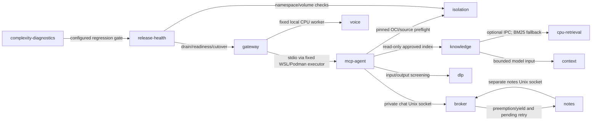

# Complexity, interactions and loud failures

This ledger asks whether a component earns its maintenance cost. It is an authored map, not proof of exhaustive failure coverage. The initial inventory measures 356 functions across 54 owned Python modules. See [measured hotspots](COMPLEXITY_INVENTORY.md) and the machine-readable [component ledger](../config/system-map.json).

## Interaction map

The model stays behind the broker. Voice runs separately on CPU. A Windows, WSL, GPU or filesystem failure can still stop the entire station; process diagnostics cannot capture a kernel crash.

## Component value and failure ledger

| Component | Why retain it / review criterion | Failure modes |
| --- | --- | --- |
| gateway | Keep while LAN owner access and HTTP compatibility are required. | auth/session mismatch; interactive admission timeout; MCP child unavailable; client disconnected |
| mcp-agent | Keep while restricted tool surface can be verified independently. | child exit; protocol mismatch; incomplete stream |
| broker | Keep if chat preemption and denied arbitrary templates remain necessary. | upstream read stall; failed cancellation fence; budget exhausted; template denied; parallel-runner drift |
| isolation | Keep while offline privacy and model isolation are core requirements. | stopped WSL/containers; source/image mismatch; unexpected mount; network boundary drift |
| knowledge | Keep if source accuracy and chronology improve verifiable answers. | missing/corrupt index; metadata/index mismatch; bibliography false positive; undated source; unresolved contradiction |
| cpu-retrieval | Retain only if retrieval evaluation beats BM25 enough to justify measured latency/RAM. | worker exit; embedding pin mismatch; rerank timeout |
| dlp | Keep while owner setup privacy is required; measure false positives and missed leaks. | filter unavailable; sensitive output; quarantine permission failure; split-secret stream |
| voice | Retain voice features that improve measured interaction without starving chat. | voice busy; stopped worker; invalid reply; microphone permission/device error |
| notes | Retain if source-backed notes improve retrieval over original passages. | EOF/worker exit; broker yield or rate limit; truncation; grounding rejected; Windows crash |
| release-health | Keep while station availability and reproducible release checks are required. | scan incomplete/drift; readiness failure; drain timeout; rollback failure; reboot leaves services stopped |
| context | Keep if long-session continuity works at acceptable bounded cost. | invalid handoff; context overflow; storage failure; summary hallucination |
| complexity-diagnostics | Keep if it detects regressions and reduces incident diagnosis time. | AST parse failure; baseline regression; diagnostic sink unavailable; unmeasured JS/PS behavior |

The JSON ledger also records each invariant, ongoing cost, source files and relevant tests. Test references identify evidence to inspect; they do not assert every listed failure has been reproduced. Review a component when its benefit disappears, a fallback gives equivalent results, or its latency/resource/operator burden exceeds its benefit. Compare correctness, evidence coverage, failure containment, recovery effort and measured latency before removing it. Security boundaries need replacement evidence, not merely a lower line count.

## Regression gate

Run `python scripts/complexity.py check` or the configured `python scripts/test-local.py`. Release preparation uses that test command. Reports land in ignored `data/complexity/latest.json`; no private corpus is traversed or executed. `report --markdown docs/COMPLEXITY_INVENTORY.md` refreshes the public inventory.

AST decision counts, function lengths and owned-module import fan-out are checked against `config/complexity-baseline.json`. Existing debt is explicit; growth above an allowance fails with function, line, metric, actual and limit. New functions default to 12 decisions / 80 lines, new modules to 6 owned imports. Baseline creation requires a reason, but this is a review convention, not an authorization mechanism. Review narrowly scoped allowance edits with the diff; never regenerate the baseline just to turn a failed check green. Retire stale allowances after refactors.

Largest current review targets: retrieval `_retrieve` (103 decisions), gateway `do_POST` (74), and container validation (59). Split retrieval ranking/budgeting and gateway route handling first; preserve the isolation checks while making their rules easier to inspect. Counts are indicators, not a quality score. Dynamic imports, JavaScript/PowerShell complexity, runtime call frequency and cross-process wait cycles are outside this gate.

## Owner diagnostics

Unexpected MCP, inference, evidence, notes and voice failures emit one bounded JSON record to stderr: UTC timestamp, stable failure code, random diagnostic ID, exception types, filename/line/function frames, numeric OS/process error codes and cause links. The HUD receives a generic error plus an ID; it does not receive stack traces. MCP and notes stdout remain protocol-only. Existing owner launchers capture stderr in ignored `data/releases/<release-id>.gateway.log` and notes logs; notes worker stderr is `data/study-notes-worker.log`. Follow the ID through the logs. Do not upload private logs unchanged.

Unreviewed exception messages, absolute paths, source lines, locals, request/model text and credentials are deliberately omitted. Known authored messages now have an exact reviewed catalog. This is verbose structural evidence, not raw exception dumping. A broken stderr sink cannot mask the original failure, but its diagnostic record may be lost. No new retention service or host ACL is installed. Expected broker rejection codes retain their existing behavior. Optional retrieval fallback and voice degradation remain explicit existing behaviors; not every swallowed exception in the project has been instrumented.

| Code | Recovery direction |
| --- | --- |
| LARP-MCP-UNAVAILABLE | Inspect owner gateway stderr and frozen release/source/OCI pins; no direct model fallback. |
| LARP-MCP-STREAM | Inspect matching error ID; retain transcript, mark partial reply incomplete, retry only after boundary checks. |
| LARP-VOICE-UNAVAILABLE | Check pinned CPU voice service and protocol; text remains usable, no cloud fallback. |
| LARP-NOTES-TRANSPORT | Check worker stderr, process exit and active notes container; current window remains pending. |
| LARP-NOTES-WORKER | Inspect cause chain and notes-only broker status; do not save partial JSON. |
| LARP-EVIDENCE-UNAVAILABLE | Check approved-index, manifest/provenance binding and text screening; do not infer without evidence. |
| LARP-INFERENCE-UNAVAILABLE | Check selected broker readiness and pinned model; no direct or cloud fallback. |
| LARP-CATALOG-REJECTED | Read scope. skill or persona: only that entry stays unavailable. catalog: the registry document failed and no persona is served. Checkout-only as of 2026-10-20; not in the selected release. |

On a stream failure, retain the browser transcript, mark partial output incomplete and investigate the ID before retrying. Notes transport retries retain the pending window and preserve worker IDs. Never bypass the broker or switch to a cloud service to recover.

## Update scope

The initial implementation was checkout-only. It was subsequently included in the frozen release recorded in [STATUS.md](STATUS.md), through [UPDATES.md](UPDATES.md). Model/voice images, bindings, authentication and owner data were not replaced. New edits remain checkout-only until the release workflow is repeated.

## Checkout validation

The isolated unittest suite reported 205 tests OK, with two platform/data skips. Chat streaming, context, voice, teaching, memory and diagnostic-ID Node checks passed. The complexity gate and approved broker prompt-hash check passed. These are checkout/synthetic tests, not a new static scan receipt or live deployment acceptance. The station was stopped at that original check; subsequent activation and workload restart are recorded in [STATUS.md](STATUS.md).

See [second- and third-order consequences and the Windows workload shutdown](INTERACTION_CONSEQUENCES.md) for propagation chains, observed events and unresolved causes.

[Verbose error catalog and local diagnostic lookup](VERBOSE_ERRORS.md) describes exact known messages and unknown-error limits.
