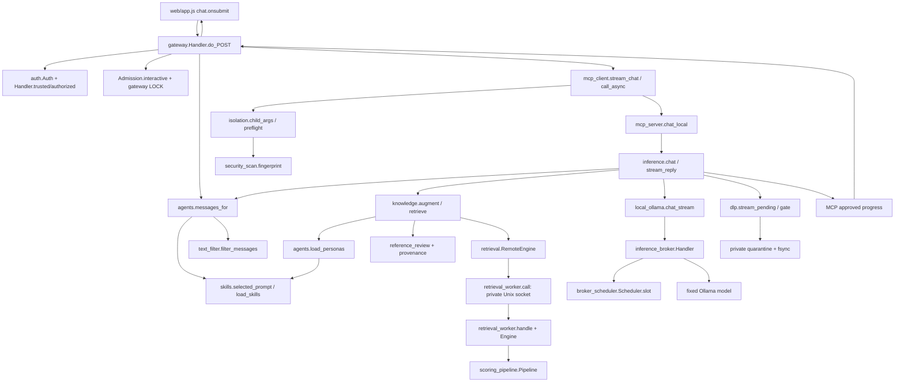

# Dependency map - inspected checkout

Static evidence: `data/modularity-audit/source-map.json`, generated from 98 owned
Python modules under `runtime/` and `scripts/`. Downloaded `data/github` mirrors
were excluded. Imports include deferred/conditional imports; this is not a
complete dynamic call trace. Source functions establish the following main path.

The diagram shows calls and data flow, not which thread owns every operation.
Gateway compression, voice and owner maintenance are separate branches:
`gateway.do_POST` calls `context.compression_messages` before MCP for compression;
`model_routes.switch` calls owner `ModelSwitch`, while `voice.call` invokes its
own pinned CPU worker. `health.watch` invokes recurring checks outside ordinary
chat. [Source inventory](module-inventory.md) defines their failure behavior.

## Static import cycles

| Component | Exact source edge | Interpretation |
| --- | --- | --- |
| `isolation → security_scan → mcp_client → isolation` | `isolation.preflight` deferred import; security_scan top-level `child_parameters`; mcp_client top-level `child_args` | Hashing is coupled to scanner/discovery orchestration. Deferred import avoids ordinary initialization failure but does not remove the dependency cycle |
| `knowledge → retrieval → retrieval_worker → knowledge/retrieval` | `knowledge._engine`; `RemoteEngine.__init__`; `retrieval_worker.serve` | Shared IPC client/server/model responsibilities; mostly deferred, and serve runs in a different process. Not proof of recursive inference |
| `model_backend ↔ scripts.releases` | Backend imports releases; releases startup helpers import Backend | Owner lifecycle cycle, outside the normal untrusted chat tool surface |

These are source-level strongly connected components, not demonstrated deadlocks.
Priority is the first cycle: isolate pure fresh fingerprint calculation behind a
dependency-light interface and keep a compatibility wrapper for scanner callers.
Do not move or weaken the integrity decision. The worker and owner cycles should
be changed only with an independent-test or maintenance benefit.

## Mutable state and hidden dependencies

- `gateway.PERSONAS`, `inference.PERSONAS` are separately initialized dictionaries;
  `agents.load_personas` validates the full skill catalog. `knowledge._retrieve`
  loads that registry again, even after inference selects a valid persona.
- `mcp_server.WINDOW_START/CALLS` and its lock are process-local. Reusing a child
  would change limiter lifetime unless tested explicitly; it is not merely a
  transport swap. Gateway Auth and broker limits have different owners/scopes.
- `retrieval._ENGINES/_REASONS` cache initialization, including unavailable
  engines. `scoring_pipeline.Pipeline.requested/error/last_used` are worker state.
- `model_routes._CONTROLLER` is a shared lazy model-switch controller;
  `ModelSwitch.state/pending` and the broker scheduler's fault/active/history
  fields are mutable under their respective locks.
- `skills.ROOT` is reused as a path anchor by unrelated modules. Isolation mode,
  broker lane and retrieval worker selection also depend on process environment.
  These are trusted deployment/owner settings, not currently client profile data.

Source: [gateway](../../runtime/gateway.py), [inference](../../runtime/inference.py),
[MCP server](../../runtime/mcp_server.py), [retrieval](../../runtime/retrieval.py),
[model routes](../../runtime/model_routes.py), [scheduler](../../runtime/broker_scheduler.py).

## Synchronization and duplication

Gateway LOCK, cooperative Admission locks, inference LOCK, broker Condition and
the retrieval worker's serial socket loop each serve different domains.
Removing them as apparently duplicate locks is not justified by this graph.
Gateway and child message screening cross a process/trust boundary; repeated
validation there is not automatically redundant. Registry loading again inside
knowledge, scanner imports for pure hashing and repeated DLP prefix processing
are candidates for measurement, not pre-approved removals.

The checkout extraction removes the isolation -> scanner -> MCP client ->
isolation hash cycle: both orchestration modules now consume pure
`source_integrity`. Bounded observation acquisition and immutable profile/trace
modules have independent tests. Knowledge/retrieval/worker and owner model/release
cycles remain deferred. The after source map contains 104 owned Python modules.

Confidence: high for static edges/state and the extracted hash dependency;
moderate for exclusive runtime cost and race behavior. Selected cancellation/
fault tests and live numeric traces have run; they are not exhaustive race tests.
See [measured scope](../EXECUTION_PROFILES_PERFORMANCE_2026_10_20.md).
